# MusicTage

本地音乐播放器 + 在线歌词匹配 + 音效处理，Android 8.0+（minSdk 26 / targetSdk 35）。

不登录、不接流媒体、不上传任何东西 —— 只播你手机里的歌。

## 下载

| 版本 | 文件 | 大小 | 校验 |
|---|---|---|---|
| 2.5.6 | [MusicTage_2.5.6_release.apk](https://github.com/laitang1111-exe/MusicTage/releases/download/v2.5.6/MusicTage_2.5.6_release.apk) | 22.88 MB | [SHA-256](#校验值) |

> 本包使用正式签名证书（v2 + v3），与早期 debug 签名版本不兼容。
> 若之前装过旧版，请先卸载再安装（卸载会清空歌单与设置）。

## 截图

### 播放与歌词通知

| 播放器 | 歌词通知（悬浮） |
|---|---|
| 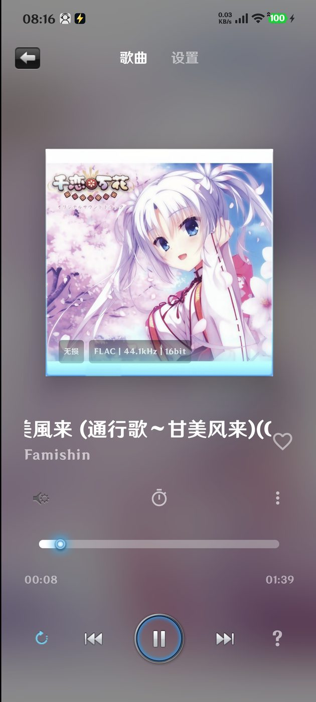 | 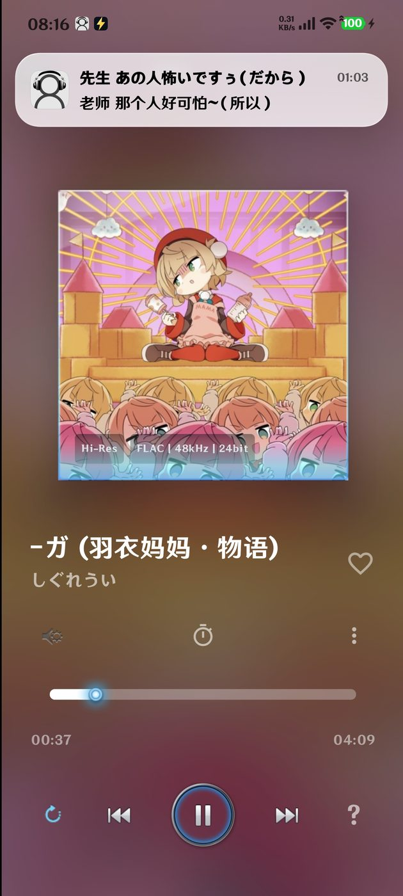 |

| 横屏歌词通知（带译文） | 横屏歌词通知（原文） |
|---|---|
| 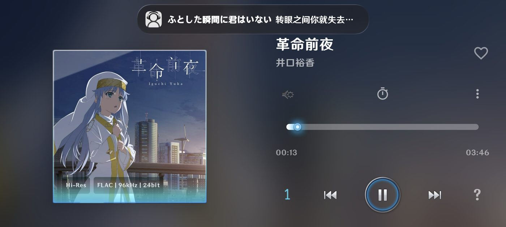 | 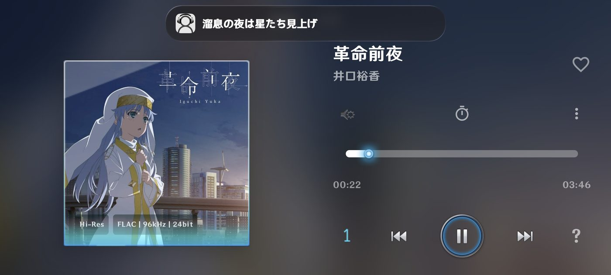 |

### 音乐管理

| 歌曲列表 | 长按菜单 |
|---|---|
| 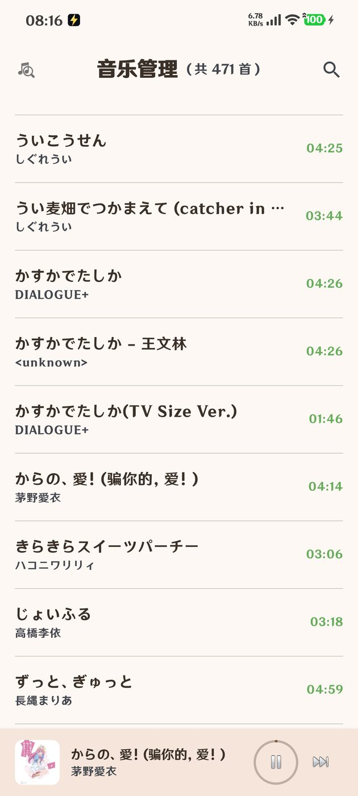 | 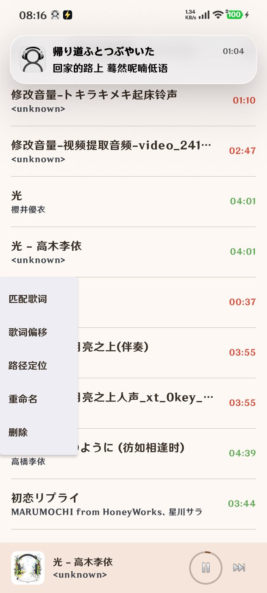 |

| 路径定位 | 全局扫描确认 |
|---|---|
| 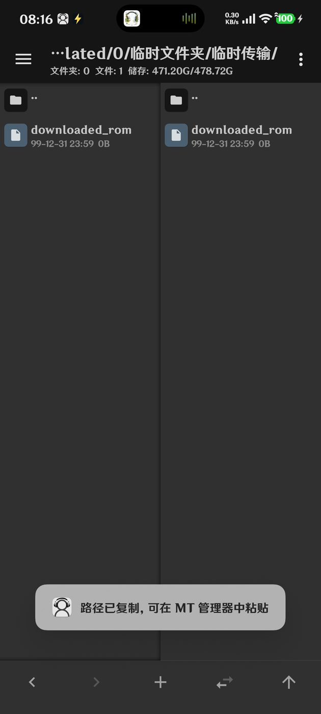 | 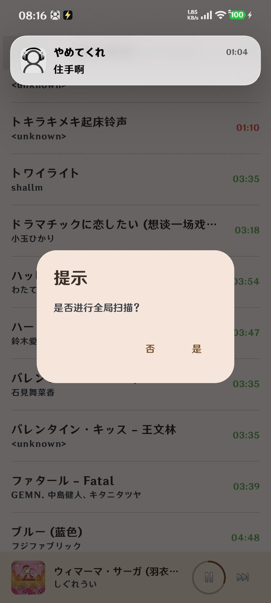 |

### 歌词匹配

| 第一步：搜索候选 | 第二步：确认保存 |
|---|---|
| 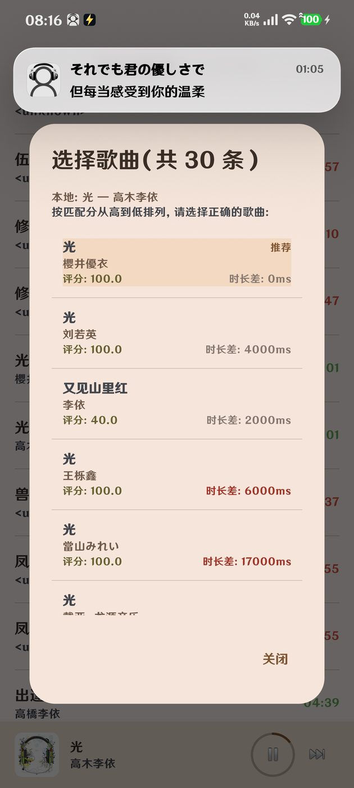 | 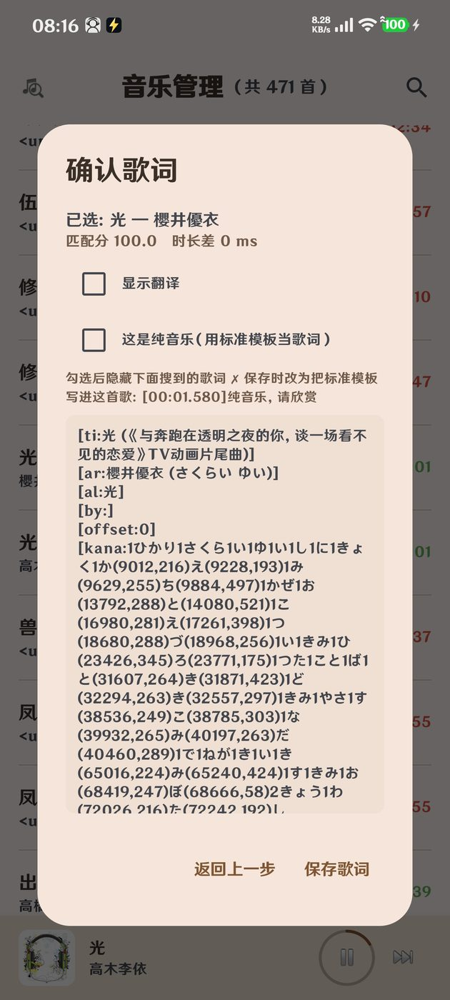 |

| 歌词偏移调整 |
|---|
| 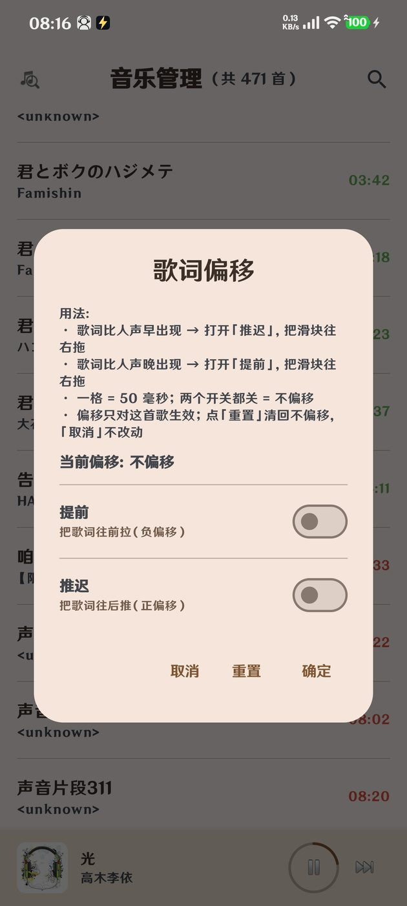 |

### 音效与其它

| 音效设置 | 设置弹窗 |
|---|---|
| 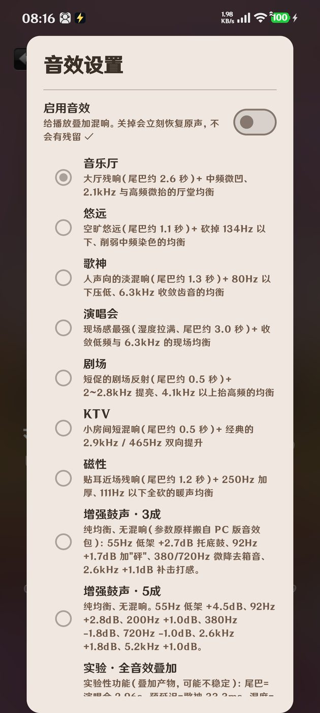 | 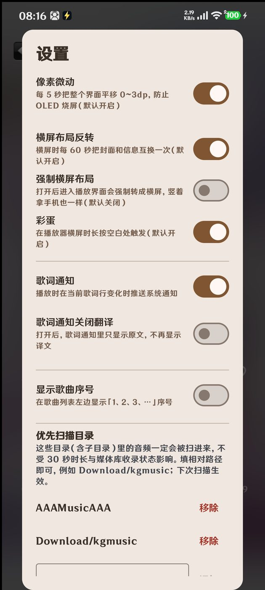 |

| 定时关闭 | 歌曲通知 |
|---|---|
| 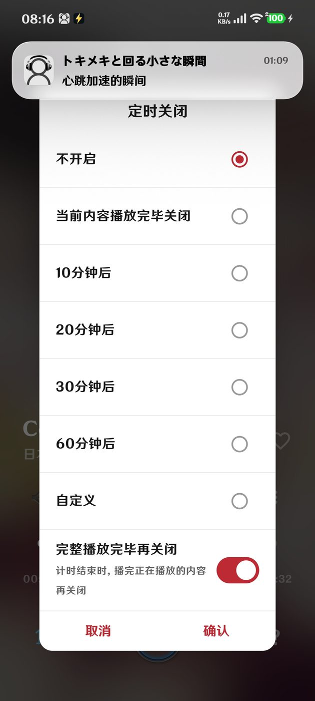 | 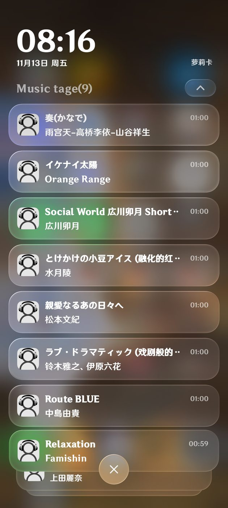 |
## 功能

完整清单见 [musictage功能大全.md](musictage功能大全.md)，摘要如下：

- **播放**：后台播放、通知栏控制、四种播放模式、横屏布局、像素微动防烧屏、睡眠定时
- **歌词**：LRC / 酷狗 KRC（逐字）/ QQ QRC 解析，在线匹配与打分，译文轨道，通知栏歌词，每首歌独立偏移
- **音乐管理**：列表搜索、长按菜单（匹配歌词 / 歌词偏移 / 路径定位 / 重命名 / 删除）、时长按有无歌词着色
- **音效**：大厅混响、参数均衡、双输出、软削波、峰值限制
- **彩蛋**：ChilledWindows 特效；冷启动"伪闪退"，再点图标直达音乐管理

## 安装

```bash
# 首次安装
adb install MusicTage_2.5.6_release.apk

# 覆盖升级（同签名）
adb install -r MusicTage_2.5.6_release.apk

# 从旧 debug 签名版本迁移
adb uninstall com.example.musictage
adb install MusicTage_2.5.6_release.apk
```

需要权限：读取媒体音频、通知、所有文件访问（访问非媒体库目录的音乐）。

## 构建

```bash
git clone https://github.com/laitang1111-exe/MusicTage.git
cd MusicTage
./gradlew :app:assembleDebug
```

环境：JDK 11+、Android SDK 35、Gradle Wrapper（随仓库提供）。

## 目录结构

```
app/src/main/java/com/example/musictage/
├── MainActivity.kt              入口、扫描、通知
├── PlaybackService.kt           MediaSession + 前台服务 + 歌词通知
├── PlayerViewModel.kt           播放状态与队列
├── PlayerScreen.kt              播放界面
├── DatabaseManagementActivity.kt 音乐管理列表
├── SettingsDialog.kt            设置
├── SleepTimerDialog.kt          睡眠定时
├── ChilledFx.kt                 彩蛋特效
├── data/                        Room 数据库、酷狗/QQ 接口与歌词解析
└── utils/                       歌词匹配、音效处理、扫描、偏好设置
```

## 校验值

```
文件      MusicTage_2.5.6_release.apk
SHA-256   238FE1549230014ECB14CFA8DF7330B9B799AAB90CA9917ED3586BD7CF5E04AB
versionName 2.5.6
versionCode 256
```

## 已知限制

- 逐字歌词时间目前只存在解析层，未落库
- 在线歌词匹配依赖第三方接口，接口变动会导致失败
- 只支持本地文件，不接入流媒体
- 音效处理会增加 CPU 占用

## 许可

[MIT](LICENSE)

第三方音乐接口与歌词版权归各自平台所有，本项目仅作个人学习与自用。
